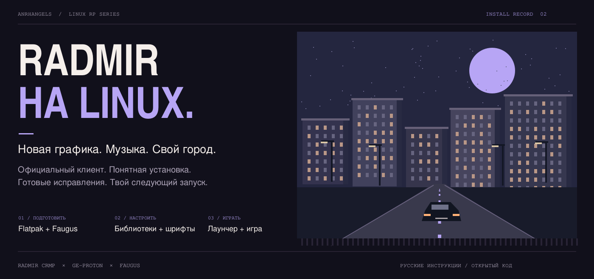
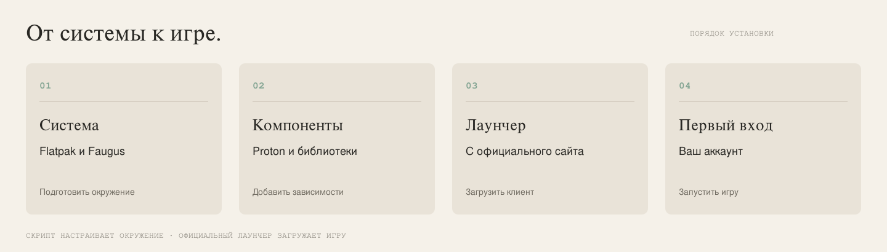
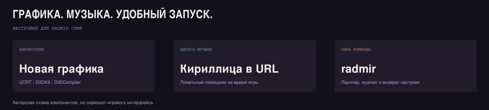

<p align="center"></p>

<p align="center">
  <a href="#установка"><b>Установить игру</b></a> ·
  <a href="docs/fixes.md">Графика и музыка</a> ·
  <a href="docs/troubleshooting.md">Нужна помощь</a> ·
  <a href="docs/advanced.md">Для опытных пользователей</a>
</p>

```text
LINUX RP SERIES / 02
RADMIR CRMP НА LINUX
Установка · новая графика · музыка · удобный запуск
```

**Установить Radmir CRMP можно двумя способами:** скачать проект командой Git или распаковать ZIP-архив. Выберите один способ — результат одинаковый.

Наш установщик подготовит программы для запуска Windows-игры на Linux, скачает официальный лаунчер и добавит ярлык. В лаунчере вы сами скачаете игру и войдёте в аккаунт. Знать Wine и Proton для этих шагов не нужно.

Это инструкция для **RADMIR CRMP на GTA San Andreas**. Другие игры общего лаунчера, включая GTA V, здесь не проверены.

> **Что уже проверено:** на Arch Linux игра запускалась с новой графикой, а исправление музыкальных адресов убрало прежнюю ошибку загрузки музыки. Обновлённый установщик и помощники проходят автоматические тесты; полный повтор установки с нуля новым скриптом ещё предстоит проверить в игре. Для других дистрибутивов подготовлены команды установки, но игровой запуск нами пока не подтверждён. [Подробнее →](docs/compatibility.md)

<a id="установка"></a>

## 01 / Как установить

Нужны 64-битный компьютер с Linux, интернет, свободное место для игры и установленный драйвер видеокарты с поддержкой Vulkan. Подготовлены **Arch/CachyOS/Manjaro, Ubuntu/Mint/Debian, Fedora и openSUSE Tumbleweed**. Для других вариантов сначала откройте [страницу дистрибутивов](docs/distributions.md).

Перед началом закройте Faugus, игру и её лаунчер. Faugus — программа для запуска Windows-игр; если вы её ещё не ставили, установщик сделает это сам.

### Способ 1. Через Git

**1. Откройте «Терминал» в меню приложений.** Это окно, в которое вставляют команды. Нажимать на файлы проекта пока не нужно.

**2. Проверьте, установлен ли Git:**

```bash
git --version
```

Появилась версия? Продолжайте. Написано «команда не найдена»? [Установите Git по инструкции для своей системы](docs/installation.md#установка-git) или перейдите к способу с ZIP ниже.

**3. Скопируйте весь блок в терминал и нажмите Enter:**

```bash
git clone https://github.com/anrhangels/linux-radmir-rp.git "$HOME/linux-radmir-rp" &&
cd "$HOME/linux-radmir-rp" &&
bash install.sh
```

Первая строка скачает проект в домашнюю папку, вторая откроет его, третья запустит настройку. Знаки `&&` запускают следующий шаг только при успехе предыдущего. Не добавляйте `sudo` перед этим блоком.

Если написано, что папка `linux-radmir-rp` уже существует, [откройте её и проверьте файлы](docs/installation.md#папка-уже-существует). Не удаляйте её наугад.

**4. Продолжите по разделу «Что нажимать во время установки» ниже.**

### Способ 2. Вручную скачать ZIP

Git для этого способа не нужен. ZIP содержит тот же установщик; вручную подбирать библиотеки не потребуется.

1. **[Скачайте ZIP-архив](https://github.com/anrhangels/linux-radmir-rp/archive/refs/heads/main.zip)**. Или на странице GitHub нажмите зелёную кнопку **Code → Download ZIP**.
2. Откройте скачанный архив и нажмите **«Извлечь» / «Распаковать»**. Не запускайте файлы прямо из архива.
3. Откройте распакованную папку `linux-radmir-rp-main`. Внутри должен лежать файл **`install.sh`**.
4. Нажмите правой кнопкой на свободном месте в этой папке → **«Открыть в терминале»**. [Если такого пункта нет →](docs/installation.md#как-открыть-терминал-в-нужной-папке)
5. Вставьте команду и нажмите Enter:

```bash
bash install.sh
```

### Что нажимать во время установки

Одинаково для обоих способов:

1. Установщик покажет список действий и вопрос `Начать установку? [y/N]`. Введите английскую **`y`** и нажмите Enter.
2. Если появится запрос пароля, введите пароль своего пользователя Linux. **Пароль может быть невидимым при вводе — это нормально.** Нажмите Enter.
3. Дождитесь загрузки и настройки компонентов. Не закрывайте терминал. Если официальный установщик сам открыл лаунчер, закройте его окно, чтобы наш скрипт закончил работу.
4. Дождитесь сообщения **«Готово»**. Если появилась ошибка, [найдите её в разделе помощи](docs/troubleshooting.md); продолжать как после успешной установки не нужно.

### Как открыть игру

Найдите **Radmir CRMP** в меню приложений. Если ярлыка пока нет, откройте терминал и выполните:

```bash
~/.local/bin/radmir
```

В официальном лаунчере выберите **RADMIR CRMP**, дождитесь скачивания игры и введите игровой никнейм. Затем запускайте игру; при желании выберите новую графику. При запуске командой оставляйте терминал открытым до выхода из игры и лаунчера: в нём работает помощник для музыки.

**В следующий раз просто открывайте ярлык или выполняйте команду выше. Устанавливать всё заново перед каждой игрой не нужно.**

[Подробная инструкция с пояснениями каждого шага →](docs/installation.md)

<p align="center"></p>

## 02 / Что установится автоматически

| Вам нужно… | Установщик сделает это сам |
| :--- | :--- |
| Подготовить Linux | Установит Flatpak и остальные нужные инструменты через пакетный менеджер вашей системы |
| Запустить Windows-игру | Подготовит Faugus, Proton и UMU |
| Скачать лаунчер | Получит актуальный официальный EXE и проверит его контрольную сумму |
| Использовать новую графику | Установит библиотеки UCRT, D3DX9 и D3DCompiler, которые помогли в нашей проверке |
| Настроить текст | Добавит свободные шрифты для кириллицы и эмодзи |
| Удобно играть | Создаст ярлык, команду `radmir`, журналы и необязательную панель FPS |

Системный Wine вручную устанавливать не требуется. Драйвер видеокарты должен быть готов заранее. Саму игру скачивает официальный лаунчер; аккаунт и никнейм выбираете вы.

Обычная загрузка скрипта хранится в его кэше. Для уже скачанного EXE учитываются системная папка загрузок, `Downloads` и `Загрузки`.

## 03 / Графика, музыка и экран

<p align="center"></p>

**Новая графика.** В исходной проверке игра падала на обработке графических эффектов. После установки нужных оригинальных библиотек Microsoft игра запустилась.

**Музыка.** Часть адресов музыкальных файлов содержала кириллицу в кодировке, которую игра не открывала. Локальный помощник исправляет такие адреса во время сеанса. Он работает только на вашем компьютере, не подменяет DLL игры и не меняет системный прокси Linux.

**Экран.** Если подключён экран 1920×1080, помощник при необходимости временно делает его основным для Xwayland. Разрешение, масштаб и расположение экранов не меняются. После выхода прежний выбор восстанавливается.

[Как устроены исправления и как их отключить для проверки →](docs/fixes.md)

## 04 / Если что-то не получилось

| Что вы видите | Что сделать |
| :--- | :--- |
| `install.sh: No such file or directory` | [Откройте терминал в правильной папке](docs/installation.md#как-открыть-терминал-в-нужной-папке) |
| Скрипт просит закрыть игру или Faugus | Закройте их и повторите команду |
| Ошибка скачивания | [Помощь с загрузками](docs/troubleshooting.md#загрузка) |
| Новая графика не запускается | [Проверка библиотек](docs/troubleshooting.md#графика) |
| Музыка по-прежнему не загружается | [Проверка запуска и помощника](docs/troubleshooting.md#музыка) |
| После прерванного запуска остались сетевые настройки | Закройте игру и выполните `~/.local/bin/radmir --restore` |
| Квадраты вместо букв | [Шрифты и эмодзи](docs/fonts.md) |
| Другая ошибка | [Поиск по симптомам](docs/troubleshooting.md) |

Проверить основные файлы после установки:

```bash
~/.local/bin/radmir --check
```

Панель FPS: **F10** переключает режимы, **F12** скрывает или показывает её. Ограничение FPS не задаётся.

## 05 / Дополнительные инструкции

Для параметров установки, проверки без изменений и восстановления откройте [техническое руководство](docs/advanced.md). Для обычного запуска эти настройки не нужны.

| Руководство | Что внутри |
| :--- | :--- |
| [Подробная установка](docs/installation.md) | Git и ZIP, терминал, пароль, первый и повторный запуск |
| [Техническая справка](docs/advanced.md) | Параметры, префиксы, пути, диагностика и восстановление |
| [Дистрибутивы](docs/distributions.md) | Зависимости и особые системы |
| [Графика и музыка](docs/fixes.md) | Причины исправлений и их границы |
| [Результаты проверок](docs/compatibility.md) | Что подтверждено и что ещё нужно проверить |
| [Словарь](docs/glossary.md) | Незнакомые слова простым языком |

Работа над проектом велась с помощью ИИ — **OpenAI Codex GPT-6.1-Sol**. [О проекте и участии ИИ](docs/about.md).

[Все инструкции](docs/README.md) · [Официальные источники](docs/sources.md) · [Сообщить о проблеме](https://github.com/anrhangels/linux-radmir-rp/issues/new/choose)

<p align="center"><sub>LINUX RP SERIES / 02 · Независимая инструкция сообщества · Код и собственные иллюстрации — MIT</sub></p>
